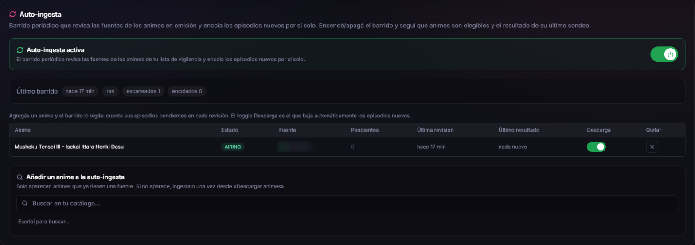
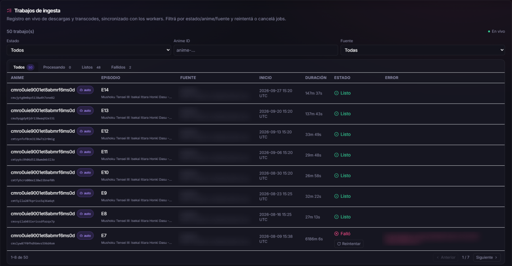
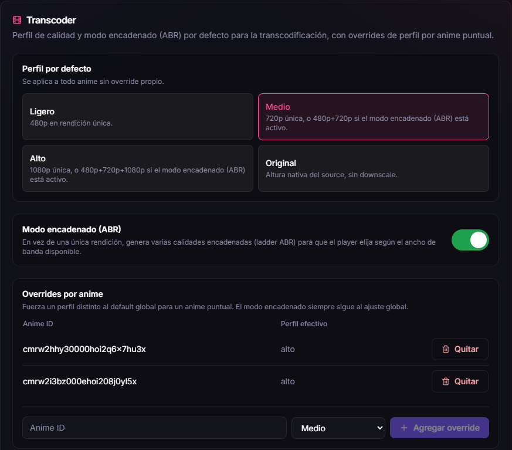
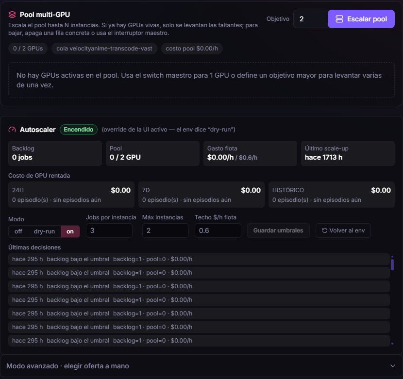

The product imports only the public index of each core capability
(`@velocity/core-*`); internal subpaths are forbidden by an ESLint rule rather
than by convention. Every dependency is wired in one composition root and passed
down as ports.

Delivery is HLS with AES-128 and signed playback tickets. Ingest is admin-only,
subtitles ship embedded in the source.

Most of the engineering lives on the admin side, in a pipeline that takes an
episode from "it exists somewhere" to "it plays, encrypted, in the right
quality" without anyone touching it. What follows is that pipeline, module by
module. The screenshots come from the production admin panel (the interface is
in Spanish); third-party source names and internal paths are blurred. The code is
private — this is the problem and the decision, not the implementation.

## Scheduled auto-ingest: the site keeps itself current

An admin curates a watch-list of airing series. A sweep runs on a timer — every
30 minutes by default — and, for each series, compares the source's episode list
with what the catalogue already holds. Only the missing episodes are enqueued,
through the same ingest path a person would use, so nothing downstream knows or
cares who started the job.

What makes it safe to leave alone:

- **Opt-in download per series.** With the toggle off, the sweep still counts the
  pending episodes so the admin sees what is waiting, but downloads nothing.
- **Caps that fail closed.** Three episodes per series, ten per sweep, fifty
  series per sweep and a pause between series (the defaults, all configurable).
  Caps are applied whole-or-nothing per series: a sweep never enqueues half of a
  batch.
- **No overlapping sweeps.** A tick that lands while the previous sweep is still
  running is skipped, yet it still refreshes the worker heartbeat — a long sweep
  must not look like a dead worker.
- **A kill switch that is honoured mid-sweep.** Turning it off in the UI aborts
  the run between two series; it does not wait for the next tick.
- **Deduplication against the full set of job keys**, not the latest 200 rows, so
  a growing history cannot cause a re-download. The sweep also visits the least
  recently checked series first.
- **Crash-tolerant reporting.** Results are persisted per series, so a crash
  loses at most the series that was in flight.

Auto-ingest is one of several timers in the worker, next to metadata
enrichment, a reconcile sweep between database and storage, and a media purge.

### Proof that it runs unattended

The **auto** badge only appears on jobs created by the sweep, not by a person.
Episodes 8 to 14 arrived a week apart, between 16 August and 27 September, and
finished on their own. Episode 7 failed on a storage read and stays in the list
with a retry button instead of disappearing. Today the watch-list holds a single
airing series; the sweep and its caps are sized for fifty.

## Downloading

Two engines share one discovery interface.

**Ingest queue.** A BullMQ queue with five attempts and a custom backoff. The
mirrors throttle each connection, so a file is fetched over several ranged
connections at once (aria2c, with a segmented fetch as fallback) and the
throttle stops mattering. The response body is checked before it counts as a
video, so an HTML error page can never be published as an episode. Failures are
surfaced to the queue on purpose, so the retry policy lives in one place.

**Download to PC.** Same discovery, but the episode ends up in the admin's
browser as an MP4 instead of in the catalogue. It is staged on the server,
handed over through a single-use link with an expiry, and cleaned up on a timer.
It does no transcoding and takes no catalogue storage. One download at a time, a
cap on queued jobs, and cancelling really kills the underlying process.

Content sources sit behind a single provider port — search, info, download,
resolve — with a router that picks by domain and a health canary that chooses
the healthiest provider per series. A new source is one adapter.

## Transcoding

A source file becomes token-gated, adaptive HLS. Workers can run on a CPU or on a
rented GPU, and a worker joins the fleet with nothing but an API URL and a key
(keys are hashed and shown once).

- **Quality profiles.** Light is 480p, medium 720p, high 1080p, and original keeps
  the native height. With the chained (ABR) mode on, a profile produces a ladder
  of renditions so the player can switch with the available bandwidth. A series
  can override the global profile.
- **A job must fail loudly.** A guard rejects output that decodes as green
  garbage instead of publishing it, and a watchdog kills an `ffmpeg` that stops
  reporting progress — it exists because of a job that sat there for fourteen
  hours.
- **Idempotent state.** A job's ID is the media's ID; the state machine goes
  pending, processing, ready or failed, and failed back to processing on retry.
  The worker callback is HMAC-signed and idempotent. This closed a race where two
  workers could take the same episode and report a false success.
- **Reapers that cannot be catastrophic.** The orphan reconcile has a delete cap
  per run, a grace period and a guard that refuses to run when the numbers look
  wrong. The orphan reaper rescues active jobs and keeps their ID.
- Scene thumbnails and embedded-subtitle extraction run in the same pipeline.
- **Delivery.** The AES-128 key is only served with an unexpired signed token, and
  segment paths carry an HMAC token scoped to one media prefix; without it the
  proxy answers 403.

## Rented GPUs and the autoscaler

When the queue backs up, transcoding can move to a GPU rented by the hour.

- **Three modes.** Off, dry-run — which records its decisions without acting —
  and on.
- **Hard limits, not good intentions.** Jobs per instance, a maximum number of
  instances and an hourly ceiling for the whole fleet. Scale-up and scale-down
  are pure functions with hysteresis, plus idle shutdown, zombie detection and a
  cost ledger.
- **A memory of bad hosts.** Hosts that fail to start are vetoed with a reason;
  at the time of writing the list held 68 hosts, 57 of them for start-up
  timeouts and 7 for lacking a hardware encoder.
- **Honest status.** In the capture it is idle: zero backlog, pool at 0 of 2, the
  last scale-up about ten weeks earlier. The CPU worker absorbs the weekly volume
  by itself; the GPU pool is for when a backlog builds up.

## Around the pipeline

- **Approval.** Episodes go through pending, approved and rejected states, with
  filters by problem (missing title, missing thumbnail) and keyboard shortcuts.
- **Catalogue metadata.** AniList enrichment, LLM-translated synopses and a
  series-group builder with a chronological veto.
- **Access control.** Supabase JWTs verified against the issuer's JWKS (ES256) and
  a role guard on every admin route.
- **Observability and recovery.** Prometheus metrics from the worker, with a rule
  against high-cardinality labels, a daily database dump with a read-only history
  and a written disaster-recovery plan.
